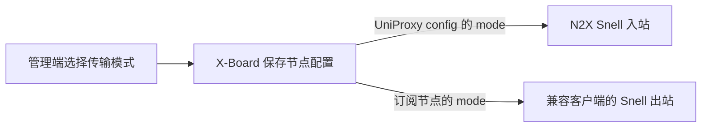

# Snell v6 传输模式配置与下发设计

实现说明 · 2026-11-20

Snell v6 节点编辑页提供「传输模式」。X-Board 按节点保存 `mode`，并用同一个值生成 N2X 节点配置和兼容客户端的订阅。两端使用相同模式才能建立连接。

管理端提供 `default` 和 `unshaped` 两种加密模式。官方的 `unsafe-raw` 适用于单独的隔离部署。

## 官方协议行为

| `mode` | Snell 加密 | 流量整形 | 适用场景 |
| --- | --- | --- | --- |
| `default` | AES | 开启，由两端根据 PSK 自动生成 | 常规部署，缺省值 |
| `unshaped` | AES | 关闭 | 需要减少填充开销时实测选用，协议版本仍为 6 |
| `unsafe-raw` | 明文 | 关闭 | 调试、隔离内网或外部已有安全隧道 |

服务端和客户端均使用 `mode`，取值必须一致。省略时双方各自采用 `default`。Surge 客户端策略应明确写 `version=6`，低于 v6 的策略带 `mode` 会报配置错误。官方 v6 取消了 v5 的 QUIC Proxy Mode，现有 UDP 转发仍可使用。 [官方发布说明](https://kb.nssurge.com/surge-knowledge-base/release-notes/snell) · [Surge Snell 手册](https://manual.nssurge.com/policies/snell.html#mode)

`dns-ip-preference` 控制 Snell 服务端连接目标时怎样选用 DNS 返回的 IPv4 或 IPv6 地址，取值为 `default`、`prefer-ipv4`、`prefer-ipv6`、`ipv4-only`、`ipv6-only`。`listen` 控制客户端能连到服务端的哪些监听地址，官方服务端可同时监听 IPv4 和 IPv6。这两项留在服务端，后续如需面板控制，可分别设计 N2X 的 DNS 和监听配置。 [官方技术介绍](https://nssurge.com/blog/snell-v6/) · [Surge Snell 手册](https://manual.nssurge.com/policies/snell.html)

## 改动前的链路

| 入口 | 原有行为 | 代码位置 |
| --- | --- | --- |
| 管理端 | Snell v6 编辑器提供 PSK 和 ShadowTLS v3 配置 | X-Board-Admin `src/views/server/components/SnellForm.vue`、`src/domain/protocolSettings.ts` |
| 保存和节点配置 | Snell 配置模型及校验表包含 PSK 和 ShadowTLS。`UniProxy/config` 输出 `version`、`psk` 和可选 `shadowtls`，没有 `mode` | X-Board `app/Models/Server.php`、`app/Http/Requests/Admin/ServerSave.php`、`app/Services/ServerService.php` |
| N2X 入站 | `SnellNode` 没有 `mode` 字段，面板多用户入站创建 `NewMultiService` 时写死 `snellv6.ModeDefault`。本地静态 sing-box 配置可用 `mode`，走另一条入站路径 | N2X `api/panel/node.go`、`core/sing/inbound.go`、`core/sing/snell.go` |
| 客户端订阅 | Mihomo、X-APP 专属 YAML 和 sing-box JSON 带 `version=6`、`psk`、每用户 `userkey`，省略 `mode` | X-Board `app/Protocols/ClashMeta.php`、`app/Protocols/ArtstationX.php`、`app/Protocols/SingBox.php` |
| Surge 订阅 | 当前未导出面板托管的 Snell 节点。面板入站要求每用户 `userkey`，Surge 官方手册的 Snell 策略没有公开该参数 | X-Board `app/Protocols/Surge.php`、N2X `core/sing/snell.go`、[Surge Snell 手册](https://manual.nssurge.com/policies/snell.html#parameters) |

核对基线为 X-Board-Admin `d2fd5c6`、X-Board `f661570e`、N2X `9589f68`。N2X 锁定的 `sing-snell` 已能解析三种模式并用其创建多用户服务。 [N2X Snell 接入说明](sing-box.md#node-types-are-not-always-panel-types)

## 保存和下发



1. **管理员配置。** 在 Snell v6 表单选择「默认（加密与整形）」或「仅加密（关闭整形）」并保存。字段存入现有 `protocol_settings.mode`。新节点及缺字段的旧节点按 `default`。更新已有 Snell 节点时，旧管理端缺交 `mode` 则保留当前值，选回默认时显式提交 `default`。服务端拒绝空值、未知值和 `unsafe-raw`。
2. **一条监听一个模式。** 绑定到同一实际监听的父子节点共享模式，子节点显示继承值。节点配置和订阅都取实际监听节点的模式。`protocol_overrides` 为 `null` 的旧子节点也取实际监听节点的值。若要同时提供两种模式，创建不同的监听端点。
3. **节点配置。** `buildNodeConfig` 在 `/api/v1/server/UniProxy/config` 返回顶层 `mode: "unshaped"`，默认值省略。N2X 把缺省值归一为 `default`，通过 `snellv6.ParseMode` 传入 `ServerOptions.Mode`。直连和 ShadowTLS 后的 Snell 入站共用该字段。仅清除或补写默认值时无需重载，实际变化走现有重载路径。若本轮用户列表或在线状态拉取失败，保持当前入站并在下次拉取时重试变更。
4. **客户端订阅。** Mihomo 与 X-APP 的 YAML 在 Snell 节点写顶层 `mode: unshaped`，sing-box 在 Snell 出站对象写 `"mode": "unshaped"`。默认模式省略字段。Mihomo 和 X-APP 复用 `snell_v6=1` 门槛，sing-box 走现有的已知内核版本门槛。兼容内核还需支持每用户 `userkey`。

ShadowTLS 是外层传输。Mihomo 的 `obfs-opts.mode: shadow-tls` 继续配置外层，Snell 顶层 `mode` 配置内层。sing-box 仍由 Snell 的 `detour` 引用原有 ShadowTLS 出站。节点 PSK、每用户 `userkey`、权限和流量归属沿用现有路径。

### 订阅示例

Mihomo 和 X-APP 的 Snell 节点切换到 `unshaped` 时，输出如下。示例使用占位凭据。

```yaml
proxies:
  - name: Snell v6
    type: snell
    server: node.example.com
    port: 7177
    version: 6
    psk: example-shared-key
    userkey: example-user-key
    mode: unshaped
    udp: true
```

官方 Surge 策略使用 `version=6, mode=unshaped`。要给 Surge 下发面板托管节点，先单独验证它能满足当前多用户认证，或设计独立的兼容接入方式。 [Surge Snell 手册](https://manual.nssurge.com/policies/snell.html)

## 切换与回退

- **先升级 N2X。** 旧 N2X 会忽略新字段并继续用 `default`。在节点端完成升级后，再在面板选 `unshaped` 并用刷新后的订阅确认握手。
- **优先新增节点试运行。** 用独立端口和试用用户组，拉取订阅并验证 TCP、UDP 和按用户计量，再扩大可见范围。旧端点可继续服务缓存了旧订阅的客户端。试用异常时隐藏新节点，客户端刷新后使用旧端点。
- **原端口切换按有中断处理。** N2X 会重建入站，客户端也要刷新订阅。安排维护时段，保存后确认节点重载完成，再用新订阅验证。回退时，面板选回 `default`，等节点重载后刷新客户端。
- **明文模式单独开放。** 当前多用户实现会把用户 UUID 用作 `userkey`，`unsafe-raw` 下连这个握手字段也是明文。公共节点、普通订阅和共享用户凭据均不开放该值。将来有隔离部署需求时，对监听范围、安全隧道和凭据范围作单独设计。

## 本地验证

在 macOS 上用本地 sing-box `1.14.4` 源码构建的二进制跑 Snell v6 多用户入站，分别用同版本 sing-box 和 Mihomo `d569d9eba` 构建的客户端做 `127.0.0.1` TCP 回显。测试使用占位凭据和临时配置目录。

| 本地用例 | 结果 |
| --- | --- |
| 两端缺省，或一端显式 `default` | 两种客户端均收到回显 |
| 两端均为 `unshaped`，`userkey` 正确 | 两种客户端均收到回显 |
| `default` 与 `unshaped` 混配，分别交换两端 | 两种客户端均未收到回显，连接关闭或超时 |
| `unshaped` 下缺失或使用错误 `userkey` | 两种客户端均被拒绝 |
| 两端均为 `unsafe-raw`，回环内使用测试 `userkey` | sing-box 通过。Mihomo 一次连接重置，随后通过 HTTP CONNECT 做对照复测，`unshaped` 与 `unsafe-raw` 均收到回显 |

上表为设计阶段的本地内核对照。实现后的 Go 用例覆盖两种模式在 N2X 上的直连、ShadowTLS、TCP/UDP、按用户计量和撤销。X-Board 用例覆盖模式校验、旧编辑器保存、父子节点继承及三种订阅格式。实际 Surge 和 X-APP 安装包仍需设备侧验证。

在各自仓库运行以下本地回归命令。

```sh
# X-Board-Admin
npm test -- src/domain/protocolSettings.spec.ts

# X-Board
php artisan test --filter='ServerSaveSchemaCoverageTest|NodeConfigProtocolParamsTest|ServerProtocolInheritanceTest|SnellProtocolTest|ManagementNodeAccessTest'

# N2X
go test ./api/panel ./core/sing ./node -run 'Snell|Reload'
```
